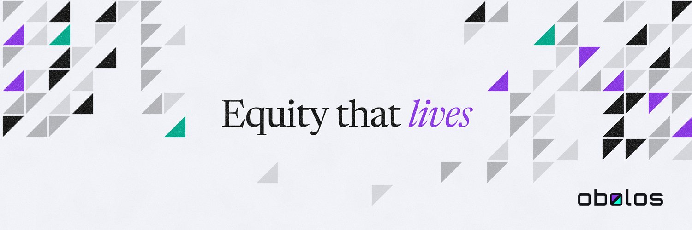

# obolos equity

The obolos plugins for AI agents, as a [Claude Code plugin marketplace](https://code.claude.com/docs/en/discover-plugins).

## Documentation

How to connect an assistant, and how each thing is done in obolos: [obolos help](https://app.obolos.io/help/connect-an-assistant).

## Plugins

| Plugin | Description |
| --- | --- |
| [obolos](plugins/obolos) | Incorporate a Delaware company and run it on obolos from the day it is filed: cap table, share issuance, SAFEs and fundraising rounds. Claude also answers from your account: your companies, holdings, rounds, data rooms and messages |

## Install

```
/plugin marketplace add equitylayer/obolos-equity
/plugin install obolos@obolos-equity
```

Then restart Claude Code and run `/mcp` to sign in to obolos.

## Security

See [SECURITY.md](SECURITY.md).

## License

obolos Source Available License 1.0. See [LICENSE](LICENSE).
